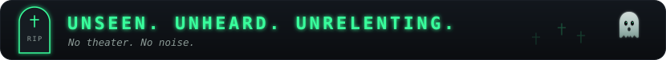
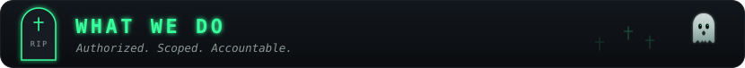
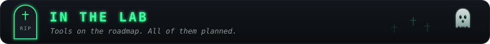
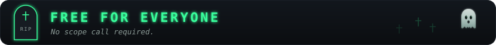
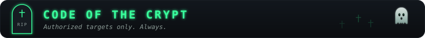
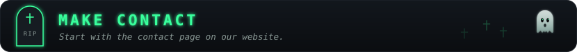

 

<h2 align="center"></h2>

**Ghost Protocol Labs (GHPL)** is an offensive security lab. We run authorized security engagements and build tools for defensive teams.

We help organizations find where trust breaks down: simulating credible threats, testing the surfaces they expose, and turning what we find into decisions they can act on. We do it with restraint and with respect for the systems people depend on.

| 🔏 Authorized | 🎯 Scoped | 🧾 Accountable |
|:---:|:---:|:---:|
| Written permission before anything is touched. | Agreed targets, boundaries and rules of engagement. | Findings documented honestly and followed through. |

<h2 align="center"></h2>

Every engagement is scoped first, authorized in writing, documented throughout and followed through afterwards. [Full details on our services page.](https://ghost-protocol-lab.github.io/Ghost-Protocol-Lab/services.html)

| | Service | What it is | You get |
|---|---|---|---|
| 🕶️ | **Red Team Engagements** | A realistic, authorized adversary scenario that tests how your organization responds, aligned to your business objectives. | Prioritized report · stakeholder debrief · retest plan where scoped |
| 🌐 | **Web Application Pentesting** | A focused, authorized review of a web application's security posture. | Findings with business context · technical report · debrief |
| 📦 | **Application Pentesting** | Assessment of a defined application or software product against agreed objectives. | Evidence-based findings · remediation guidance · debrief |
| 🛰️ | **Network + Infrastructure** | Evaluation of agreed network and infrastructure boundaries, with operational continuity in mind. | Scope-aligned report · risk-prioritized recommendations |
| 🕵️ | **OSINT + Recon Assessment** | What public information reveals about an agreed organization, brand or exposure surface. | Documented exposure summary · improvement guidance |
| 🎭 | **Social Engineering + Physical Security** | Agreed human and physical scenarios under explicit authorization, with defined boundaries. | Scenario-based report · leadership debrief · retest plan |
| 🛠️ | **Custom Red Team Tooling** | A scoped tooling need for authorized testing and defense, with requirements and delivery agreed up front. | Defined scope · delivery documentation · handoff |

> [!NOTE]
> Ready to talk scope? Start from the [contact page](https://ghost-protocol-lab.github.io/Ghost-Protocol-Lab/contact.html) on our website.

<h2 align="center"></h2>

Tools for authorized testing and defense are on the roadmap. All of them are still **planned**. We will publish details here as each one takes shape. See the [roadmap](https://ghost-protocol-lab.github.io/Ghost-Protocol-Lab/tools.html) on the website.

| ID | Project | Status |
|:---:|:---:|:---:|
| `GH-001` | **GHOSTGRID** |  |
| `GH-002` | **GHOSTPROXY** |  |
| `GH-003` | **GHOSTPROBE** |  |

<h2 align="center"></h2>

Not every ghost is hostile. Everything below is free, and none of it needs a scope call. Writeups cover only labs, CTFs and authorized practice targets, and they are sanitized. No client data, ever.

| | | What it is | Where |
|---|---|---|---|
| 📝 | **Writeups** | Sanitized writeups on every field of cyber, from labs, CTF-style challenges and our own practice environments. | [Damn_Practical_Write_Ups](https://github.com/Ghost-Protocol-Lab/Damn_Practical_Write_Ups) |
| 📡 | **Cyber Posts** | Short security posts, tips and updates. | Coming soon |
| 📅 | **Events** | Workshops, talks, CTF nights and community meetups. | [Damn_Practical_EventHub](https://github.com/Ghost-Protocol-Lab/Damn_Practical_EventHub) · [Damn_Practical_EventFinder](https://github.com/Ghost-Protocol-Lab/Damn_Practical_EventFinder) |
| 📬 | **Newsletter** | Security learning and updates, delivered free. | Coming soon |
| 🎮 | **Activities** | Hands-on exercises and daily fun tasks. Learn by doing. | [Damn_Practical_Activities](https://github.com/Ghost-Protocol-Lab/Damn_Practical_Activities) |
| 👥 | **Communities** | A place to ask questions and share what you learn. | Coming soon |

**Behind the scenes:** [Damn_Practical_Workflow](https://github.com/Ghost-Protocol-Lab/Damn_Practical_Workflow) describes the way we operate as an organization.

<h2 align="center"></h2>

These are the ground rules for everything we do and every space we run.

1. **Be respectful.** Courtesy toward everyone, always.
2. **No illegal activity.** Nothing unlawful, here or through us.
3. **Do not test systems without authorization.** Permission first, every time.
4. **Do not share client or private data.** It stays out of our repos, posts and chats.
5. **Do not request help attacking real targets.** We help people learn, not break into things.

<h2 align="center"></h2>

**For engagements, questions or collaboration, start with the contact page on our website.**

<!--
TODO: add your real channels here once they exist, then delete this comment wrapper.
Examples (replace TODO_ values):

-->

